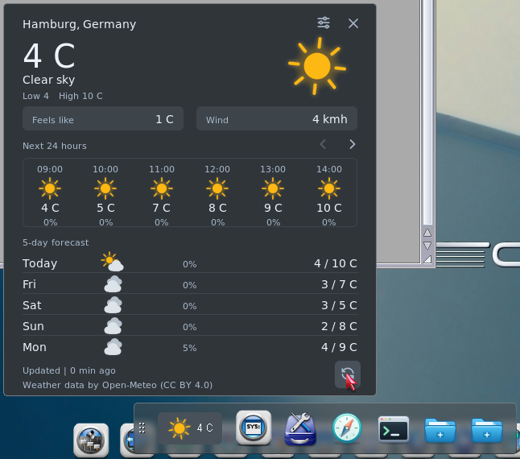
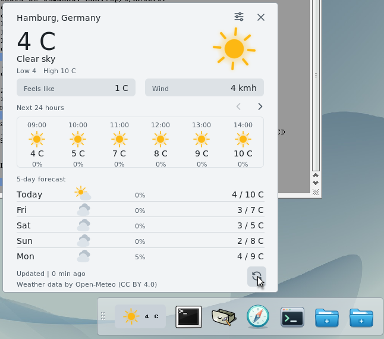
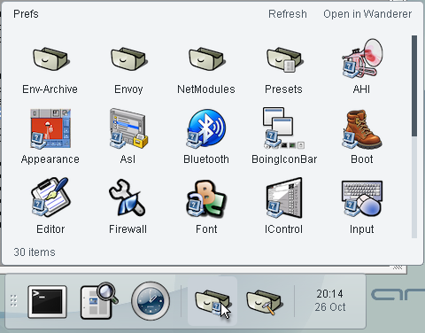

# AROS Dockbar

An Amiga-style dock for your applications, files and widgets.

[Explore the Dockbar website](https://tomaszstaniak.github.io/aros-dockbar/)



*Your launchers and the forecast, together on the desktop.*

## Get Dockbar

[Download Dockbar 0.6.2](https://github.com/tomaszstaniak/aros-dockbar/releases/tag/v0.6.2)
for mainline AROS on PC, AROS One / ABIv11 on PC, or Raspberry Pi.
Every package includes SVG icons and Weather.

Unpack the archive and open **Dockbar**. Keep the whole Dockbar drawer together.
To start it with the system, tick **Start with Wanderer** in Preferences (Defaults
for all docks) rather than copying the program into SYS:WBStartup: the start icon
runs the Dockbar in its own drawer, so its widgets are found and updates take effect.

You can also install it with [arospkg](https://github.com/tomaszstaniak/arospkg):

```sh
apkg update
apkg install dockbar
```

## More within reach

**Open drawers, not just shortcuts.** Keep a project folder, your downloads or
system tools on the dock. Open it as a panel, browse its subdrawers and launch
files from there. The panel follows changes in the drawer, so new files appear
without rebuilding a list of shortcuts.

**Drop files onto the app you want.** Set a launcher to open dropped files,
then drop a document onto your editor or viewer. Commands and scripts can also
accept dropped files — useful for actions you repeat often.

**Keep related tools together.** Hold one application over another to make a
group. Open the group as a grid, and drag shortcuts into, out of or between docks.

**Keep the forecast on your desktop.** The Weather widget shows the current
conditions and temperature on the dock. Click it for an hourly forecast and the
next five days. Add a clock alongside it. Widgets bring information and controls
to the dock; Weather is the included widget, with a package format for developers
to add more.

**Add widgets from other programs.** An application can install its own widget
into a running Dockbar. Dockbar checks that the widget fits your system, copies
it into its Widgets drawer and asks which dock to put it on. Some widgets show
only an icon with a few actions, and run only when you choose one.

## Make it yours

Drop an application from Wanderer onto the dock to pin it. Drag items to reorder
them, choose your own icons, and arrange horizontal or vertical docks around your
desktop. Choose a solid background, transparency, or just the icons.

Drag the grip to move a dock and click it for Preferences and the menu.
Shift-click an item to edit it. Removing a shortcut leaves the original file
untouched.

## A closer look

| Weather | Drawers |
| --- | --- |
|  |  |
| Current conditions, an hourly forecast and the next five days. | Browse a drawer, open its files, or continue in Wanderer. |

Weather screenshots show 0.5.2; the drawer panel is from 0.5-test12.

## Help and development

- **ReadMe** in the download covers setup and starting Dockbar with the system.
- [Release notes](https://github.com/tomaszstaniak/aros-dockbar/releases/tag/v0.6.2) cover changes and system requirements.
- [Development guide](docs/development.md) covers building, configuration and runtime options.
- [SVG dependency](docs/svg-dependency.md) documents the renderer and packaging.

Dockbar is MIT-licensed. Libraries and Weather artwork have their own terms,
listed in the package's **NOTICES**. Public builds use placeholder Weather icons;
the downloads include licensed artwork.
